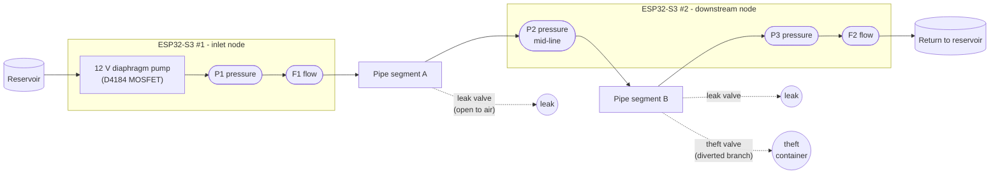
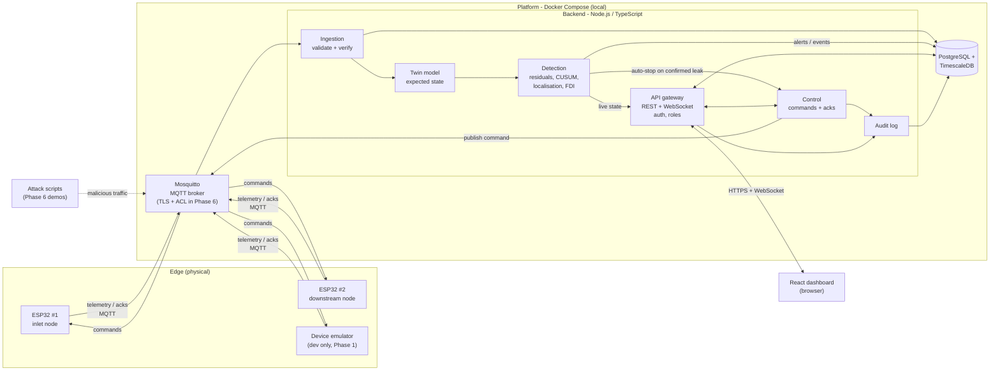
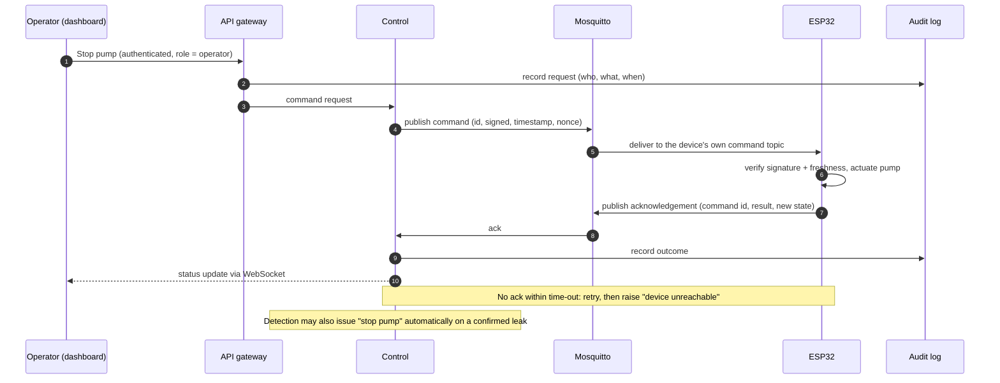
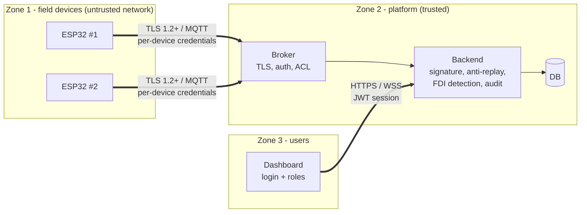

# Architecture - Pipeline Digital Twin

> Status: **Phase 0** (living document - updated at the end of every phase).
> Diagrams are written in [Mermaid](https://mermaid.js.org/); GitHub renders them
> directly. To export them as images for the thesis, paste them into
> <https://mermaid.live> and download SVG/PNG.

---

## 1. Purpose and definition

The project builds a **digital twin** of a small water-pipe prototype that stands
in for an oil/gas pipeline. It must detect **leaks** and **theft** (illegal
tapping) in real time and stay trustworthy under **cyber-attacks**.

A digital twin is not a simulation. We use the following working definition,
which also gives us the acceptance criteria for the thesis:

| # | Property of a digital twin | How this project satisfies it |
|---|----------------------------|-------------------------------|
| 1 | **Live mirroring** - the virtual state follows the physical state continuously | Every sensor reading is streamed over MQTT and updates the twin state in < 1 s |
| 2 | **Physics-based model** - the twin computes what *should* happen | Hydraulic model gives expected pressures/flows; anomalies = residual (measured - expected) |
| 3 | **Bidirectional link** - the twin acts on the physical system | Commands (pump on/off, setpoint) go back to the ESP32s, with acknowledgements |
| 4 | **Trustworthy data** - the twin can tell real physics from forged data | Authenticated devices, signed + fresh messages, physical-consistency checks against false data injection |

A simulation only has property 2. The **device emulator** (Phase 1) is a
simulation, and it is used only as a stand-in for the hardware during
development; the twin itself never depends on it.

---

## 2. Physical system



Sensor placement gives two monitored segments (A: P1 to P2, B: P2 to P3), which
is what makes **leak localisation** possible (Phase 4): a leak in segment A
changes the P1-P2 gradient differently from a leak in segment B.

### 2.1 Signals per node

| Node | Signal | Sensor | Interface |
|------|--------|--------|-----------|
| #1 inlet | P1 | Transducer 0-10 bar, 1-5 V out | ADS1115 (I2C), via divider |
| #1 inlet | F1 | YF-S201 hall-effect, pulses | GPIO interrupt counter, via divider |
| #1 inlet | Pump | 12 V 60 W, 0.8 MPa, 5 L/min | D4184 MOSFET, GPIO (on/off or PWM) |
| #2 downstream | P2, P3 | Transducer 0-10 bar, 1-5 V out | ADS1115 (I2C), via divider |
| #2 downstream | F2 | YF-S201 | GPIO interrupt counter, via divider |

### 2.2 Hardware notes (check before wiring)

These came up while designing the architecture; they affect wiring, not code:

- **ADS1115 input range.** An ADS1115 input must never exceed its supply + 0.3 V.
  Powered from 3.3 V (required so its I2C lines are safe for the ESP32), a 5 V
  sensor output would damage it. Use a divider on each pressure signal, e.g.
  10 kOhm / 20 kOhm (ratio 2/3): 1-5 V becomes 0.67-3.33 V, read with PGA
  +/-4.096 V. The ratio becomes a calibration constant in firmware.
- **One ADS1115 per board.** P1 is on board #1, P2 and P3 are on board #2, so
  at least **two** ADS1115 modules are needed.
- **YF-S201 at low flow.** Its rated range is 1-30 L/min with about +/-10 %
  accuracy; our pump gives at most 5 L/min, i.e. the bottom of the range. Each
  flow sensor must be calibrated individually (Phase 8, bucket-and-stopwatch
  method) and the mass-balance threshold must include this uncertainty.
  Nominal: frequency (Hz) = 7.5 x flow (L/min).
- **Pump is an inductive load.** Put a flyback diode (e.g. 1N5822 / SS34)
  across the pump if the D4184 module does not include one. 60 W at 12 V means
  a supply of at least 5 A.
- **Common ground** between the 12 V supply, sensors, ADS1115 and both ESP32s.
- **Pressure ripple.** A diaphragm pump produces pulsating pressure; firmware
  will oversample and average (Phase 7) and the twin will filter (Phase 4).

---

## 3. Software architecture



### 3.1 Components

| Component | Responsibility | Phase |
|-----------|----------------|-------|
| **Data contract** (`packages/contracts`) | Topics, JSON Schemas, TS types - shared by everyone | 1 |
| **Device emulator** (`tools/emulator`) | Publishes exactly what the ESP32s will publish; injects leak / theft / attacks | 1 |
| **Mosquitto** | Message broker; later TLS, per-device credentials and ACLs | 0, 6 |
| **Ingestion** | Subscribes to telemetry, validates schema, verifies signature + freshness, stores | 2, 6 |
| **TimescaleDB** | Raw telemetry (hypertables), events, alerts, commands, audit log | 0, 2 |
| **Twin model** | Current mirrored state + expected behaviour from physics | 4 |
| **Detection** | Mass balance, pressure gradient, residuals, thresholds + CUSUM, leak vs theft, localisation, false-data-injection checks | 4, 6 |
| **Control** | Sends commands, tracks acknowledgements and time-outs, safety interlocks | 5 |
| **API gateway** | REST + WebSocket to the dashboard, login, roles | 3, 6 |
| **Dashboard** | Schematic coloured by state, live charts, alerts, history, controls | 3, 5 |
| **Firmware** | Sensor reading, calibration, MQTT/TLS, signing, command handling | 7 |
| **Attack scripts** (`tools/attacks`) | Reproducible attacks demonstrating each defence | 6 |

### 3.2 Telemetry path

1. ESP32 samples sensors, averages, timestamps (NTP-synchronised clock), signs, publishes over MQTT/TLS.
2. Mosquitto authenticates the device and enforces its topic ACL.
3. Ingestion validates the schema, checks signature, timestamp window and nonce (anti-replay), then stores the reading.
4. The twin updates its mirrored state and computes the expected values; detection evaluates residuals.
5. The new state, and any alert, is pushed to the dashboard over WebSocket.

### 3.3 Command path (bidirectional)



---

## 4. Detection concept (preview of Phase 4)

| Method | Physical idea | Detects |
|--------|---------------|---------|
| **Mass balance** | Flow in (F1) should equal flow out (F2) in a sealed pipe | Any loss of fluid |
| **Pressure gradient** | Pressure drop per segment depends on flow (Darcy-Weisbach / fitted model) | Leak location (segment A vs B) |
| **Residuals** | measured - expected for every sensor | Deviations from normal physics |
| **Threshold + CUSUM** | CUSUM accumulates small persistent residuals | Small leaks, with few false alarms |
| **Leak vs theft** | A leak open to air and a diverted branch produce different pressure / flow signatures and dynamics | Classification |
| **Physical consistency** | All sensors must tell one physically possible story | False data injection (Phase 6) |

---

## 5. Security architecture (preview of Phase 6)



Defence in depth - each layer stops a different attack:

| Layer | Mechanism | Stops |
|-------|-----------|-------|
| Transport | TLS on MQTT and HTTP | Eavesdropping, man-in-the-middle tampering |
| Device identity | Per-device credentials + topic ACLs | Unknown clients, device A posing as device B |
| Message integrity | Signature (HMAC-SHA256 per device) over payload | Tampering, forged commands |
| Freshness | Timestamp window + nonce cache | Replay attacks |
| Physics | Consistency checks between sensors and twin model | False data injection by a compromised/valid device |
| Users | Login, roles (viewer / operator / admin) | Unauthorised control actions |
| Accountability | Append-only audit log | Undetected misuse, supports forensics |

---

## 6. Technology choices

The suggested stack is kept, with the adjustments marked **(changed)** or
**(added)**.

| Area | Choice | Why | Alternatives considered |
|------|--------|-----|-------------------------|
| Firmware | ESP32-S3, Arduino via PlatformIO | Large library ecosystem (ADS1115, MQTT), reproducible builds | ESP-IDF: more control, slower to develop |
| Messaging | MQTT 3.1.1 / Mosquitto, TLS | Light, publish/subscribe, standard in IIoT, native ACLs | CoAP, HTTP polling, Sparkplug B (too heavy for 2 nodes) |
| Payload | JSON validated by JSON Schema | Human readable for the defence, easy to sign, small enough at our rates | CBOR / Protobuf: smaller but opaque |
| Backend | Node.js + TypeScript | One language from emulator to dashboard, shared types | Python: better scientific libs, but our maths (mass balance, CUSUM) is simple |
| Backend structure | **Modular monolith (changed)** - one service, clear modules | Fewer moving parts to deploy and explain; modules can be split later | Microservices: extra complexity with no benefit at this scale |
| Shared contract | **`packages/contracts` (added)** used by all TS code | Emulator, backend and dashboard cannot disagree on the format | Duplicate types per service |
| Storage | PostgreSQL + TimescaleDB | SQL + time-series hypertables, retention, continuous aggregates | InfluxDB: no relational data for users/audit |
| Frontend | React + **Vite (added)**, WebSocket | Fast dev server, simple build | Grafana: cannot draw a live, interactive twin schematic with controls |
| Message signing | **HMAC-SHA256 (to confirm in Phase 6)** | Hardware-accelerated on ESP32-S3; the S3's HMAC peripheral can keep the key in eFuse so firmware cannot leak it | ECDSA: non-repudiation, but slower and more complex key handling |
| Time sync | **SNTP on ESP32 (added)** | Mass balance across two boards and anti-replay timestamps both need a common clock | Backend receive time only: breaks anti-replay |
| Repo | **npm workspaces monorepo (added)** | One clone, one install, shared tooling | Several repositories |
| Deployment | Docker Compose, local | Whole stack starts with one command on the defence laptop | Kubernetes: overkill |

---

## 7. Repository layout

```
.
|-- docker-compose.yml      # local stack (infra now, app services later)
|-- .env.example            # configuration template (copy to .env)
|-- docs/                   # architecture, data contract, test reports
|-- infra/
|   |-- mosquitto/config/   # broker configuration (dev now, TLS/ACL in Phase 6)
|   `-- db/init/            # SQL run on first DB start
|-- packages/contracts/     # Phase 1 - topics, schemas, shared types
|-- services/backend/       # Phases 2,4,5,6 - ingestion, twin, detection, control, API
|-- apps/dashboard/         # Phase 3 - React dashboard
|-- tools/emulator/         # Phase 1 - device emulator
|-- tools/attacks/          # Phase 6 - attack demonstrations
|-- firmware/               # Phase 7 - ESP32-S3 PlatformIO projects
`-- scripts/                # helper and test scripts
```

---

## 8. Roadmap

| Phase | Content | Status |
|-------|---------|--------|
| 0 | Repo, Docker Compose, architecture | Done |
| 1 | Data contract + device emulator | - |
| 2 | Ingestion + time-series storage | - |
| 3 | Dashboard | - |
| 4 | Twin model + detection | - |
| 5 | Bidirectional control | - |
| 6 | Security layer + attack scripts | - |
| 7 | ESP32 firmware | - |
| 8 | Hardware integration + calibration | - |
| 9 | Results, metrics, demo script | - |
