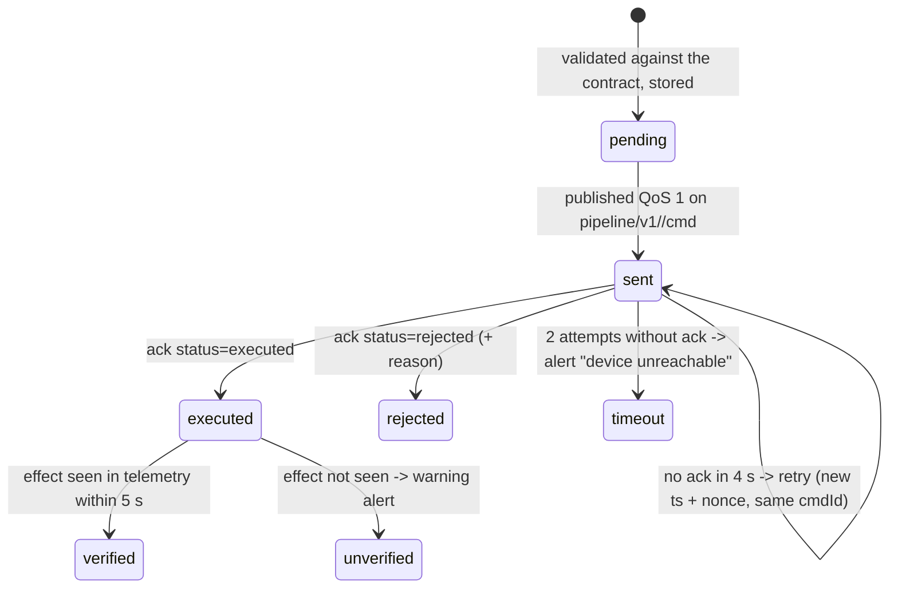

# Bidirectional control (Phase 5)

Code: [`services/backend/src/control/`](../services/backend/src/control), dashboard `ControlPanel`.

## Command life cycle

- Every attempt has a fresh timestamp and nonce: the device's anti-replay check
  would otherwise reject the retransmission. Commands are **idempotent**
  (`pump.set` is an absolute state), so a duplicate execution is harmless.
- The ack must come from the addressed device and match a pending `cmdId`.
- Round-trip latency is stored per command (`commands.latency_ms`).

## Automatic actions and interlocks

| Rule | Why |
|------|-----|
| Confirmed leak -> stop pump (policy, default on) | limit product loss / environmental damage |
| Confirmed theft -> stop pump (policy, default on) | stop the illegal draw, keep evidence |
| **No automatic action while the data-integrity alarm is open** | otherwise an attacker could forge data that looks like a leak and use the twin to shut the pipeline down (denial of service through FDI) |
| Pump restart blocked while a loss alert is open, unless `force` | the operator must confirm the repair; overrides are logged |

## API

| Method | Path | Body |
|--------|------|------|
| POST | `/api/commands` | `{ deviceId, type, params, force? }` |
| GET | `/api/commands?limit=50` | - |
| GET / PUT | `/api/control/policy` | `{ autoStopOnLeak?, autoStopOnTheft? }` |

## Measured (emulator, local broker)

- Command round trip (publish -> ack): 5-45 ms.
- Leak 0.6 L/min in segment A: detected, classified, pump stopped automatically
  and stop verified in telemetry, about 7 s after the leak started.
