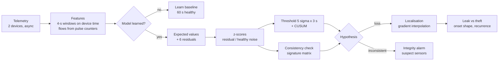

# Twin model and detection (Phase 4)

Code: [`services/backend/src/twin/`](../services/backend/src/twin).
Tests (scenarios on the emulator physics, in virtual time): `services/backend/test/twin.test.ts`.

## 1. Pipeline of one twin step (every 0.5 s of device time)

## 2. Features (de-noising and synchronisation)

- Windows are aligned on **device timestamps** (NTP), so network delay does not matter.
- Pressures = mean over the 4-s window.
- Flows = **difference of the cumulative pulse counter** / (K x dt). With a 0.5 s
  sample, one pulse = 0.27 L/min of quantisation error; over 4 s it is 0.03 L/min.

## 3. Hydraulic model (identified from data)

| Relation | Equation | Parameters |
|----------|----------|------------|
| Pump curve (affinity law for PWM duty d) | P1 = a d² - b F1² | a, b |
| Friction, segment A | P1 - P2 = RA Q_A² | RA |
| Friction, segment B | P2 - P3 = RB Q_B² | RB |
| Outlet valve | P3 = Rout F2² | Rout (tracked online: the valve is manual) |
| Mass conservation | F1 = c F2 | c (flow-meter calibration ratio) |

Parameters are **learned** from 120 healthy steady samples (60 s) by least squares
through the origin, e.g. `RA = Σ(ΔP·Q²) / ΣQ⁴`. The pump curve uses the datasheet
shape (b = 8 bar / (5 L/min)²) unless the flow varied enough to fit both a and b.
The model is stored in `twin_model` and can be re-learned after maintenance.

## 4. Residuals (analytical redundancy)

| Residual | Formula | Sensors | Holds during a real leak? |
|----------|---------|---------|---------------------------|
| mass | F1 - c F2 | F1 F2 | **no** - this is the loss |
| pump | P1 - (a d² - b F1²) | P1 F1 | yes |
| outlet | P3 - Rout (cF2)² | P3 F2 | yes |
| segA | P1 - P2 - RA F1² | P1 P2 F1 | no if leak in A |
| segB | P2 - P3 - RB (cF2)² | P2 P3 F2 | no if leak in B |
| total | P1 - P3 - RA F1² - RB (cF2)² | P1 P3 F1 F2 | bounded |

Each residual is standardised: `z = (r - μ) / σ`, with μ, σ measured during learning.

## 5. Detection

- **Threshold**: z_mass > 5 for 6 consecutive steps (3 s).
- **CUSUM** (k = 1, h = 15) on z_mass: detects small persistent losses; the
  negative side detects "fluid created" (impossible => bad data).
- **Transients**: when both flows move in the same direction (valve, pump speed)
  or the pump command changes, detection pauses for 8 s. A leak moves the flows
  in opposite directions (F1 up, F2 down), so it is never hidden by this rule.

## 6. Diagnosis: real loss or false data?

1. Loss and the relations that must hold (pump, outlet) hold, and the localisation
   is physically possible => **real loss**.
2. Otherwise => **inconsistent data** (sensor fault or false data injection).
   Isolation: each violated relation must be explained by one bad sensor; sensors
   used by a satisfied relation are exonerated; a single sensor explaining all
   violations is preferred.

| Scenario | Violated | Exonerated by | Result |
|----------|----------|---------------|--------|
| Real leak | mass (+ segA or segB) | pump, outlet | loss, located |
| Forged F1 (+0.6) | mass, pump | outlet (P3, F2) | inconsistent, **F1** |
| Downstream replays old values + leak | mass, localisation impossible | pump, outlet | inconsistent, **P2** (node-downstream) |
| P2 stuck + valve change | segA, segB (opposite signs) | pump, outlet, mass, total | inconsistent, **P2** |
| P1 drift | pump, segA, total | mass, outlet, segB | inconsistent, **P1** |
| F2 ramp | mass (negative), outlet | pump | inconsistent, **F2** |

To hide a leak an attacker must forge several sensors on two devices consistently
with the pump curve, the friction law and the outlet law at the same time.

## 7. Localisation (hydraulic-gradient interpolation)

With a leak at relative position x in segment A: `P1 - P2 = RA (x F1² + (1-x) F2²)` and
`P2 - P3 = RB F2²`. Defining

    fA = ((P1-P2)/RA - F2²) / (F1² - F2²)      fB = ((P2-P3)/RB - F2²) / (F1² - F2²)

gives fA = x, fB = 0 for a leak in A and fA = 1, fB = y for a leak in B, hence one formula:

    position = fA · LA + fB · LB

Values of fA or fB far outside [0, 1] are physically impossible and reveal bad data.
Emulator results: 0.5 L/min leak at 1.00 m -> estimated ~1.0 m; at 3.00 m -> ~2.9 m.
Limit: needs a loss large enough that F1² - F2² is measurable (about > 0.05 L/min x F).

## 8. Leak vs theft

Physically both are an opening to atmosphere. The twin uses **behaviour**:
- rise time (20-80 %) of the 4-s loss: step (leak) ~2.4 s, hand-opened valve (theft) > 5 s;
- recurrence: a loss that stops and reappears at the same place within 10 min = theft.
This is a stated heuristic; its limits are discussed in the thesis.

## 9. Validation (automated tests, virtual time)

| Test | Expected | Result |
|------|----------|--------|
| 5 min normal + valve changes + pump stop/start | no alarm | pass |
| 60 min normal with valve and duty changes | no alarm | pass (manual run) |
| Leak A 0.5 L/min | alarm < 5 s, segment A, ±0.4 m, "leak" | pass |
| Leak B 0.5 L/min + repair | segment B, ±0.4 m, resolved | pass |
| Small leak 0.15 L/min (4 %) | detected | pass |
| Theft, 10 s valve ramp | "theft", segment B | pass |
| FDI bias F1 | no leak alarm, integrity alarm, suspect F1 | pass |
| FDI replay downstream + leak | integrity alarm, suspect P2 | pass |
| P2 stuck / P1 drift | isolated | pass |
